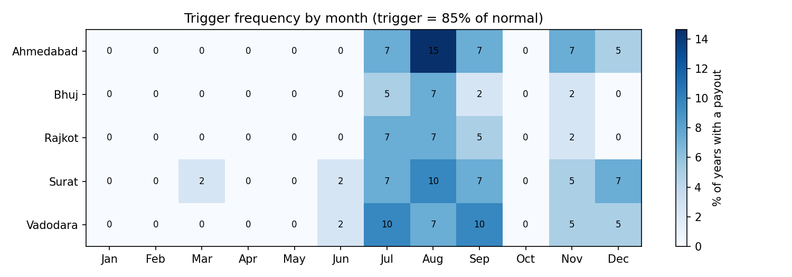
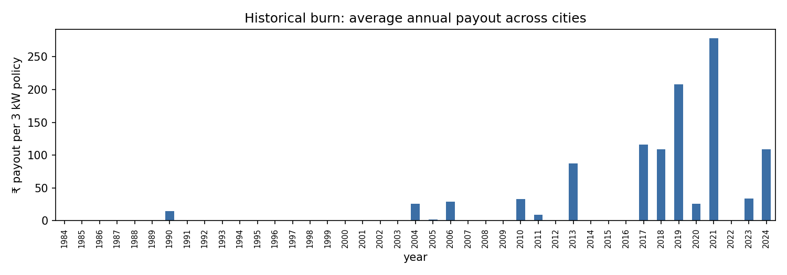
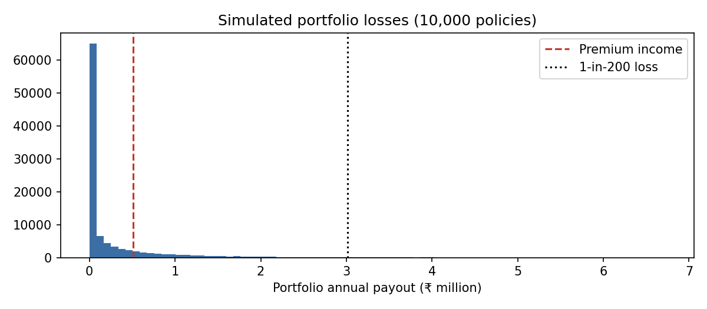
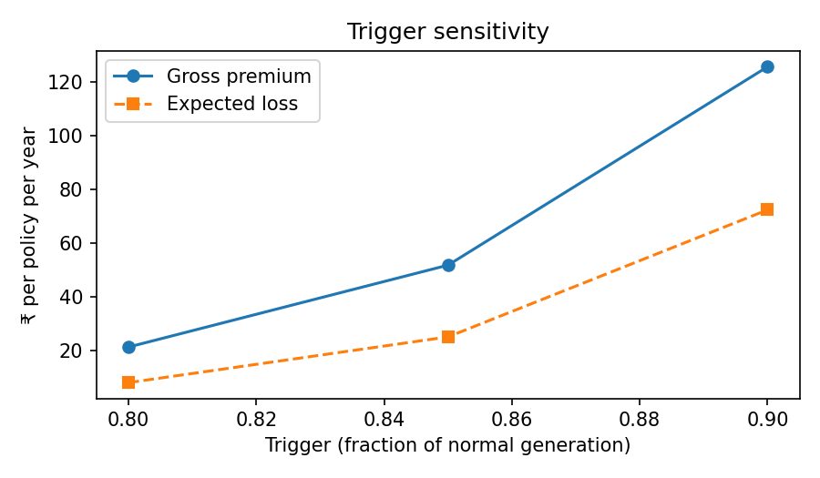
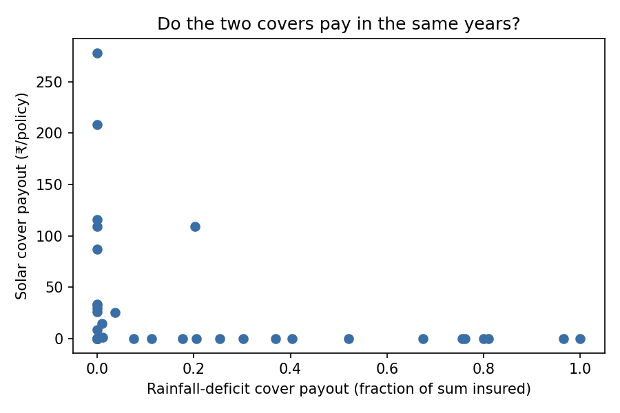

# Parametric Rooftop Solar Shortfall Insurance — Gujarat

A parametric insurance cover for household rooftop solar. It pays out automatically when **satellite-derived monthly generation** falls below a trigger, protecting households from weather-driven bill increases while their solar EMI stays fixed.

## Results (5 cities, 1984–2024)

| Metric | Value |
|---|---|
| Modelled generation | 4.25 kWh/kW/day |
| Riskiest months | Aug, Jul, Sep (monsoon) |
| Historical burn cost | ₹26 per 3 kW policy per year |
| Monte Carlo expected loss | ₹25 (within 6.2% of burn) |
| **Gross premium** | **₹51/year for 3 kW → ₹17/kW/year** |
| 1-in-10 / 1-in-25 / 1-in-100 payout | ₹94 / ₹184 / ₹308 |
| Portfolio expected loss ratio | 49% (worst historical year 2021: 547%) |
| 1-in-200 capital, 10,000 policies | ₹26.1 lakh |
| Solar vs rainfall-deficit payouts | **Spearman ρ = −0.42 (p = 0.006)** |

**Key findings**
- Solar shortfall and drought (rainfall-deficit) covers pay out in *opposite* years. This is a statistically significant natural hedge for an agricultural insurance book.
- The premium is very small because shortfalls are measured against each month's own normal. The cover is viable only when distributed in bulk, bundled with solar loans, installer warranties or DISCOM schemes, rather than sold one policy at a time.







## Run

```bash
pip install -r requirements.txt
python solar_cover.py
```

The first run downloads 41 years of NASA POWER data for 5 cities (about 1–2 minutes) and caches it in `data/`. Later runs are instant.

Outputs go to `outputs/`:
- `summary.txt`: the headline numbers
- `results.json`: everything, including per-city premiums and model checks
- `1_trigger_heatmap.png`: which months and cities trigger most often
- `2_burn_history.png`: payout the cover would have made each year
- `3_portfolio_losses.png`: simulated portfolio losses vs premium income
- `4_trigger_sensitivity.png`: premium at 80% / 85% / 90% triggers
- `5_solar_vs_rain.png`: solar vs rainfall-deficit cover payouts

## Method

| Step | What it does |
|---|---|
| Data | NASA POWER monthly all-sky irradiance (`ALLSKY_SFC_SW_DWN`) and rainfall (`PRECTOTCORR`), 1984–2024, for Ahmedabad, Surat, Rajkot, Vadodara and Bhuj |
| Generation | kWh = irradiance × days × 3 kW × performance ratio 0.77 |
| Index | ratio = month's generation ÷ that calendar month's long-run average |
| Payout | linear between trigger (85%) and exit (60%): shortfall kWh × ₹ tariff |
| Burn analysis | apply the cover to every historical year |
| Monte Carlo | per month, fit a normal distribution to each city's ratio, keep the cross-city correlation, simulate 100,000 years |
| Premium | (expected loss + 0.25 × std-dev) ÷ (1 − 20% expenses) |
| Tail | 1-in-10 / 25 / 100 payouts; 1-in-200 capital for a 10,000-policy book |
| Diversification | correlation of solar payouts with a Kharif rainfall-deficit cover (30th/10th percentile trigger/exit) |

## Assumptions to defend in interviews

All of these are set at the top of `solar_cover.py`.
- **Tariff ₹6/unit** is a placeholder. Set it to your DISCOM's residential rate.
- **Horizontal irradiance** is used, not tilted-panel irradiance. This is simpler, and it understates absolute generation, but the *ratio* to normal (which drives payouts) is much less affected.
- **Months are simulated independently.** The script prints the lag-1 autocorrelation so you can check this.
- **Normal distributions** for ratios. The script reports how many city-months fail a Shapiro-Wilk test. If many do, mention bootstrapping as the next step.
- **Basis risk:** the cover pays on modelled weather, not the household's meter. Dust, shading and panel faults are not covered.
- **Normal is the full-period mean.** Any trend in irradiance (for example haze) is not adjusted for. That is a good "next step" talking point.

## Filling the resume

Each bracket on the resume maps to a line in `outputs/summary.txt`:

| Resume bracket | Source line |
|---|---|
| [N] cities | `Cities:` (5) |
| [X] years | `Years:` (41 if all years download) |
| ₹[X]/kW/year | `Gross premium: ... ₹__/kW/year` |
| 1-in-[N]-year | pick from `Return-period payouts` (e.g. 1-in-100) |
| [negative] correlation | `Spearman rho` and its p-value |

**Use the correlation claim only if it holds.** If rho is negative *and* p < 0.05, write "statistically significant negative correlation". If it's negative but p ≥ 0.05, write "negative correlation (ρ = −0.xx)". If it's around zero, write "near-zero correlation, still diversifying". If it's positive, drop the claim.
